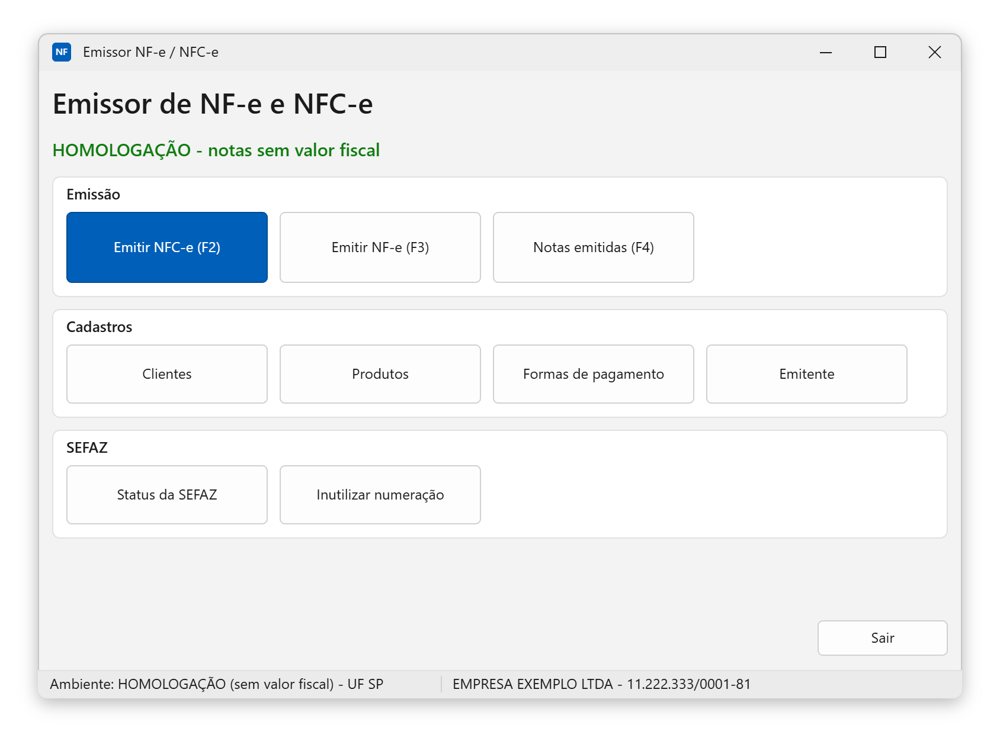
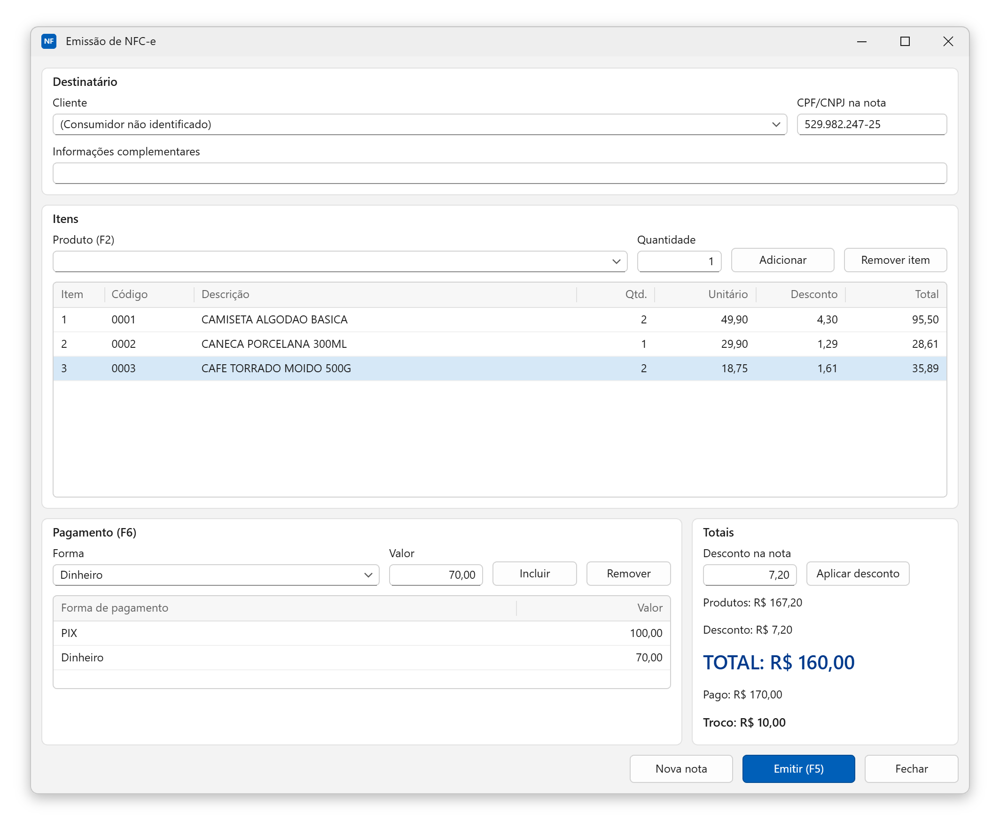
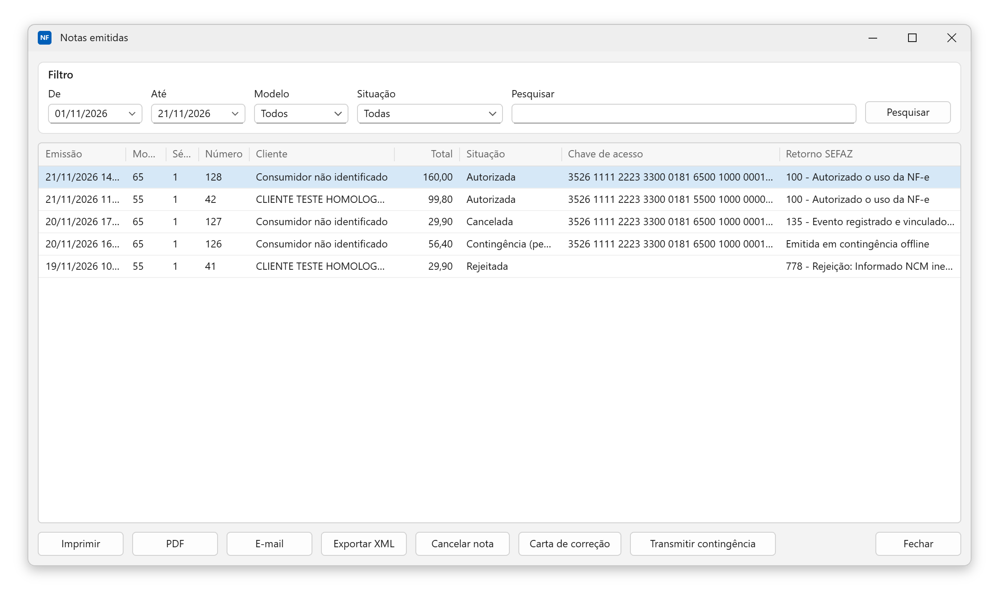
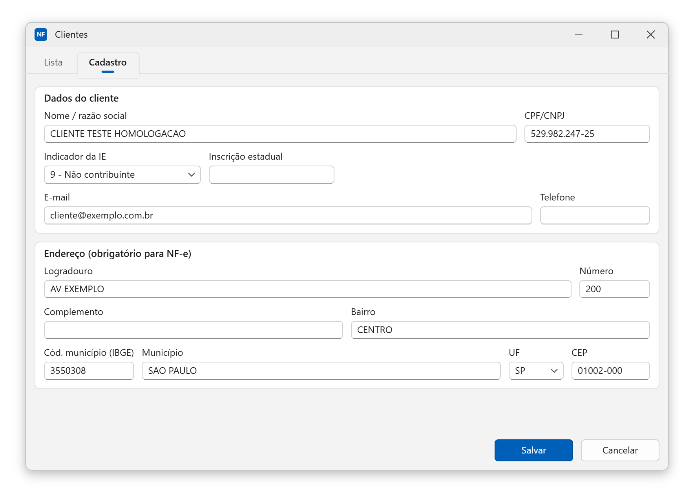
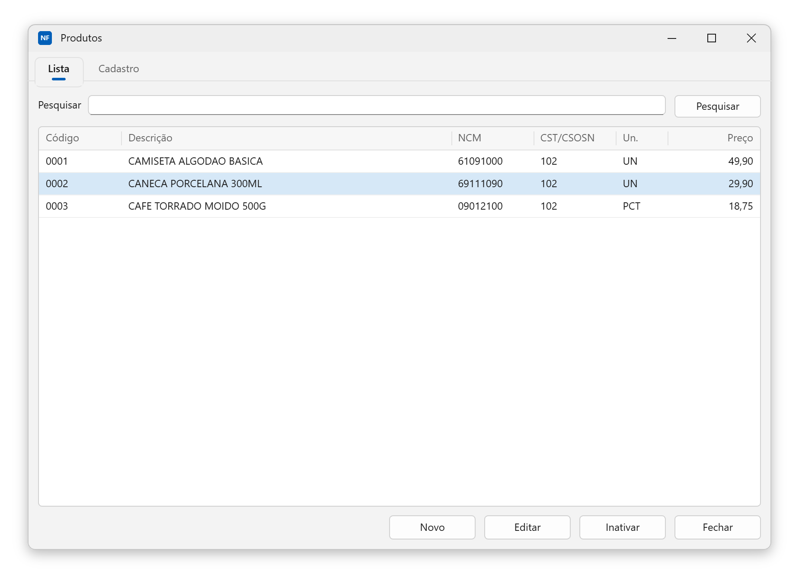
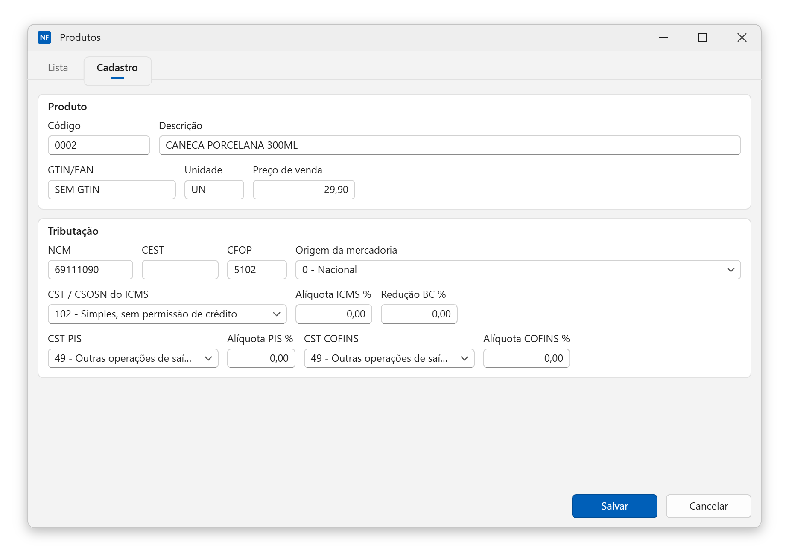
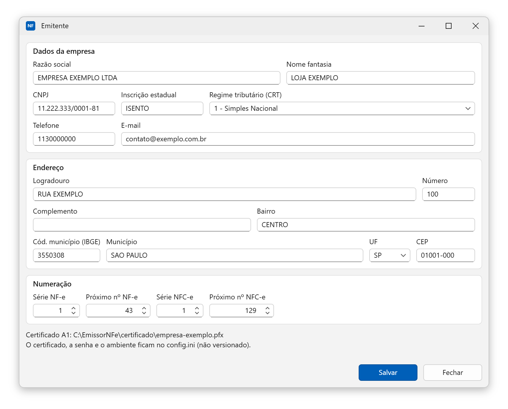
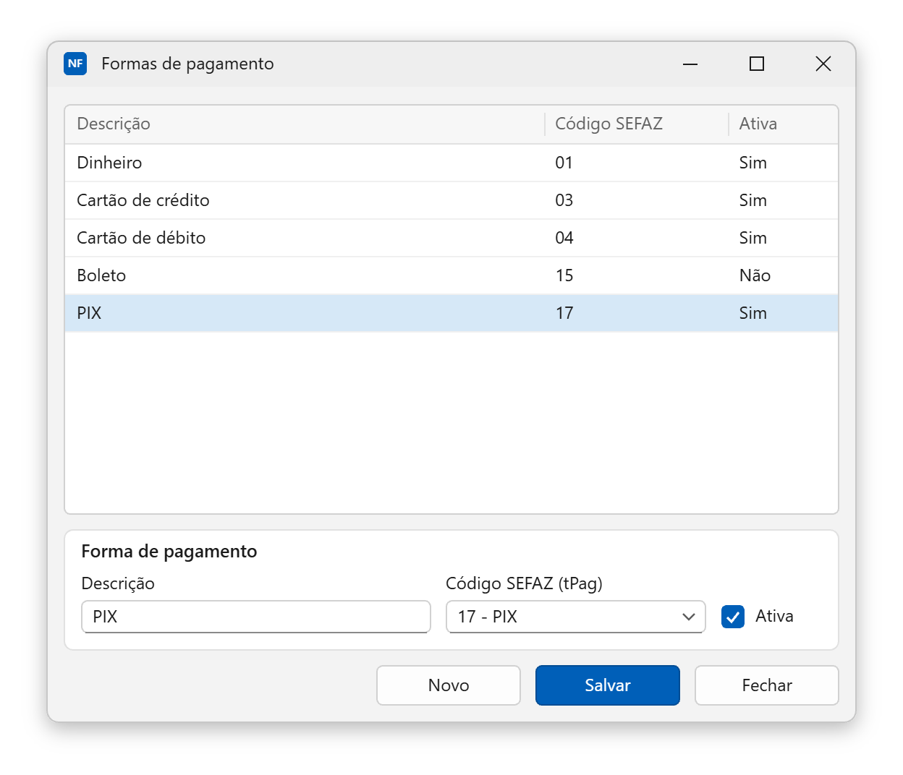
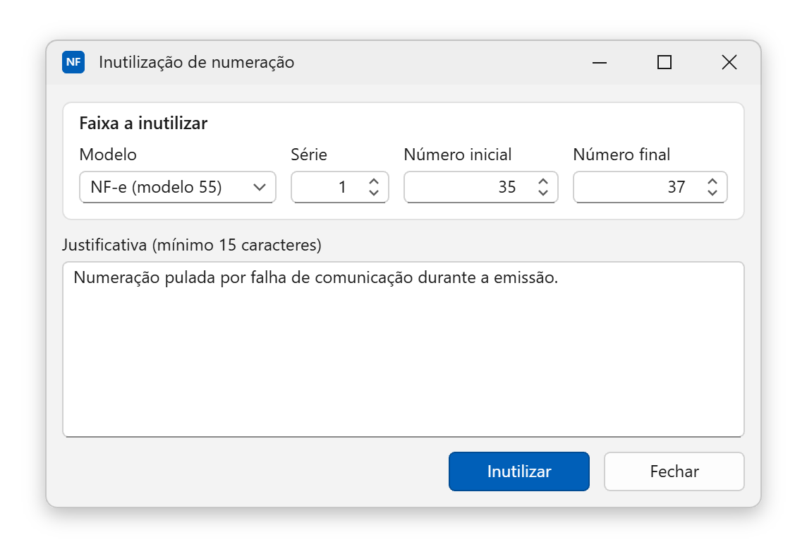
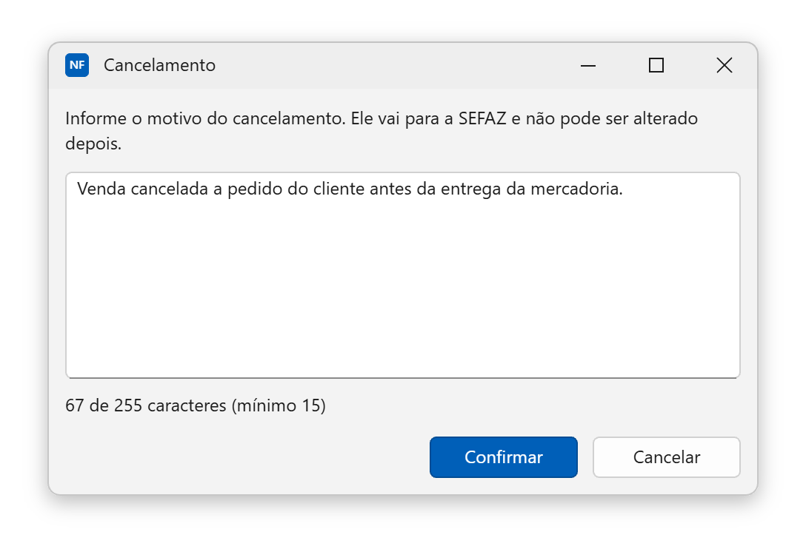

# delphi-emissor-nfe

Emissor de **NF-e (modelo 55)** e **NFC-e (modelo 65)** desenvolvido em **Delphi (VCL)** com os componentes **[ACBr](https://projetoacbr.com.br/)** e banco de dados **Firebird**, operando em **ambiente de homologação** da SEFAZ.

> Faz parte do meu portfólio. Demonstra o fluxo fiscal completo que uso no dia a dia em ERPs para varejo: cadastro, emissão, transmissão, impressão e eventos da nota.

## 🎯 Funcionalidades

- Configuração do emitente, certificado digital (A1) e ambiente (homologação)
- Cadastro de clientes, produtos (NCM, CFOP, CST/CSOSN) e formas de pagamento
- Emissão de NF-e e NFC-e com validação do XML antes do envio
- Consulta de status do serviço da SEFAZ
- Impressão de DANFE (NF-e) e DANFE NFC-e (cupom com QR Code)
- Eventos: cancelamento, carta de correção (CC-e) e inutilização de numeração
- Contingência offline para NFC-e
- Armazenamento e consulta dos XMLs autorizados
- Envio do XML e do DANFE por e-mail

## 🧱 Tecnologias

| Item | Versão / Ferramenta |
|---|---|
| Linguagem | Delphi (Object Pascal) — VCL |
| Documentos fiscais | ACBrNFe, ACBrDFe, ACBrNFeDANFeRL |
| Banco de dados | Firebird 5.0 |
| Acesso a dados | FireDAC |
| Relatórios | Fortes Report (DANFE via ACBr) |
| Componentes de interface | DevExpress VCL Controls v26.1.5 |
| Testes | DUnitX |

## 📁 Estrutura

```
delphi-emissor-nfe/
├── EmissorNFe.dproj   # Projeto principal (RAD Studio)
├── config.example.ini # Modelo do config.ini (dados fictícios)
├── src/
│   ├── Views/         # Forms VCL com DevExpress (só interface)
│   ├── Controllers/   # Ligação entre telas e services
│   ├── Services/      # Regras de negócio e fluxo fiscal
│   ├── Repositories/  # Acesso ao banco (FireDAC, SQL parametrizado)
│   ├── Models/        # Entidades e DTOs
│   └── Infra/         # Conexão, config.ini, log, XML em disco, validação de documentos
├── database/          # Scripts SQL numerados (Firebird 5.0)
├── tests/             # Testes unitários (DUnitX) com fakes
└── docs/
    └── screenshots/   # Telas do sistema (reproduções ilustrativas)
```

## 🖥️ Telas

**Tela principal**: atalhos de emissão, cadastros e serviços da SEFAZ, com o ambiente em destaque.



**Emissão de NFC-e**: itens, desconto rateado entre os itens, várias formas de pagamento e troco.



**Notas emitidas**: filtro por período, modelo e situação; impressão, PDF, e-mail, XML, cancelamento, CC-e e transmissão das notas em contingência.



<details>
<summary><b>Mais telas</b>: cadastros, emitente, inutilização e cancelamento</summary>

<table>
<tr>
<td align="center"><br>Cadastro de cliente</td>
<td align="center"><br>Lista de produtos</td>
</tr>
<tr>
<td align="center"><br>Produto: NCM, CFOP, CST/CSOSN, PIS e COFINS</td>
<td align="center"><br>Emitente, endereço e numeração</td>
</tr>
<tr>
<td align="center"><br>Formas de pagamento (código tPag)</td>
<td align="center"><br>Inutilização de numeração</td>
</tr>
<tr>
<td align="center"><br>Justificativa de cancelamento</td>
<td></td>
</tr>
</table>

</details>

## 🏗️ Arquitetura

- **ACBr isolado:** toda a comunicação com a SEFAZ passa pela interface `IEmissorFiscal`. A única implementação real é `Service.ACBr.pas`, registrada no `EmissorNFe.dpr`. O resto da aplicação, e os testes, não conhecem o ACBr.
- **Fluxo fiscal em `Service.Nota`:** validação, numeração (reservada só na primeira transmissão), envio, tratamento do `cStat`, contingência offline automática da NFC-e, cancelamento, CC-e e inutilização.
- **Rastreabilidade:** toda operação fiscal grava o XML de envio/retorno (`xml\<CNPJ>\<AAAAMM>\`), registra um evento na tabela `NOTA_EVENTO` e escreve no log diário (`logs\`).
- **Cálculos em `Currency`:** rateio de desconto sem perda de centavos, ICMS (CST 00/20), PIS/COFINS e troco, todos cobertos por testes.

## ▶️ Como executar

1. Instale o [Firebird 5.0](https://firebirdsql.org/) (os scripts também funcionam no 3.0 e no 4.0). Banco e tabelas são criados pelo próprio sistema na primeira execução (veja [Migrações](#migrações)); basta a pasta do arquivo `.fdb` existir no servidor.
2. Instale os componentes ACBr no RAD Studio pelo instalador oficial do [Projeto ACBr](https://projetoacbr.com.br/) (pacotes NFe, DANFE Fortes e Mail).
3. Instale o **DevExpress VCL Controls v26.1.5** no RAD Studio.
4. Copie `config.example.ini` para `config.ini`, ao lado do executável, e preencha o banco, o certificado A1, o CSC da NFC-e, o responsável técnico pelo software (grupo `infRespTec` da NF-e) e o SMTP. Em desenvolvimento, ligue `CriarBanco=1` e `ExecutarSeeds=1` na seção `[Migracao]` para abrir com banco, tabelas e dados de exemplo prontos.
5. Em `PastaSchemas`, indique a pasta dos schemas (XSD) da NF-e. O ACBr já traz a versão atual em `<pasta do ACBr>\Exemplos\ACBrDFe\Schemas\NFe`; apontar para ela mantém os schemas atualizados junto com o ACBr.
6. Abra o `EmissorNFe.dproj` no RAD Studio, compile e execute.
7. Na tela **Emitente**, cadastre os dados da empresa dona do certificado. Mantenha `Ambiente=homologacao`.

### Migrações

Ao abrir, o sistema cria o banco se ele não existir (com `CriarBanco=1`), aplica os scripts de `database/` que ainda não rodaram naquele banco, em ordem de nome, e registra cada um na tabela `SCHEMA_VERSAO`:

| Script | Conteúdo | Quando roda |
|---|---|---|
| `001_create_tables.sql` | estrutura: emitente, cadastros, notas, itens, pagamentos e eventos | sempre |
| `002_formas_pagamento.sql` | formas de pagamento com o código da SEFAZ | sempre |
| `003_seed_dados_exemplo.sql` | emitente fictício, produtos e cliente de teste | só com `ExecutarSeeds=1` |
| `004_seed_corrige_ncm_caneca.sql` | corrige o NCM da caneca de exemplo (6911.10.90) | só com `ExecutarSeeds=1` |

Configuração na seção `[Migracao]` do `config.ini`:

| Chave | Padrão | Descrição |
|---|---|---|
| `CriarBanco` | `0` | cria o arquivo do banco (charset UTF8) se ele não existir. Desligue em produção: um caminho errado criaria um banco vazio em vez de dar erro |
| `Executar` | `1` | `0` desliga as migrações (o banco passa a ser responsabilidade de quem implanta) |
| `ExecutarSeeds` | `0` | aplica os scripts com `_seed_` no nome. **Use só em desenvolvimento** |
| `Pasta` | `.\database` | pasta dos scripts, absoluta ou relativa ao executável |

Script já aplicado nunca roda de novo, então mudança no banco vai sempre num **script novo** com o próximo número. Seed pulado não é registrado: se `ExecutarSeeds` for ligado depois, ele roda na próxima abertura. Se um script falhar, o sistema não abre e mostra o erro.

### Testes

Abra `tests/EmissorNFeTests.dpr` e execute (console DUnitX). Os testes rodam sem banco, sem certificado e sem ACBr.

> ℹ️ O DevExpress é uma biblioteca comercial: é necessário ter uma licença válida (ou a versão de avaliação) para abrir os forms e compilar o projeto.

> ⚠️ O certificado digital e os dados reais do emitente **nunca** são versionados. Notas emitidas em homologação não têm valor fiscal.

## ✅ Funcionalidades entregues

- [x] Banco de dados e cadastros (emitente, clientes, produtos)
- [x] Configuração do ACBr e consulta de status da SEFAZ
- [x] Emissão de NF-e em homologação + DANFE
- [x] Emissão de NFC-e + DANFE NFC-e com QR Code
- [x] Cancelamento, CC-e e inutilização
- [x] Contingência offline (NFC-e)
- [x] Envio por e-mail e consulta de XMLs

## 👤 Autor

**Kauê Lessa** — Desenvolvedor Delphi Sênior
[GitHub](https://github.com/kauelessa)
